Fosse Falcons U14s &#38; Witney RFC   
  
Last weekend we joined up with Witney RFC for a joint training session&#44; followed by a short game to finish&#46; It was our first game of the season&#44; and a big welcome to everyone who played their very first game for the U14s&#33;  
  
Here’s what our captain Flo had to say&#58;  
“Our passing was really good and there was some great running too&#46; Our communication was okay&#44; but we can talk to each other more&#46; Next up&#58; spreading out&#44; getting back into position quicker&#44; marking our players and practising our scrums&#46; Overall&#44; we played really well as a team&#46; Well done everyone&#33;”   
  
Thank you to Witney for a brilliant morning&#44; and to everyone who came along to support  
  
📸 Photos by Tim hearn our brilliant parent photographer  
  
&#35;FosseFalcons &#35;GirlsRugby &#35;U14s &#35;WomenAndGirlsRugby &#35;WarwickshireRugby

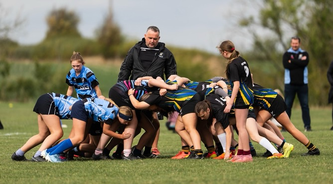
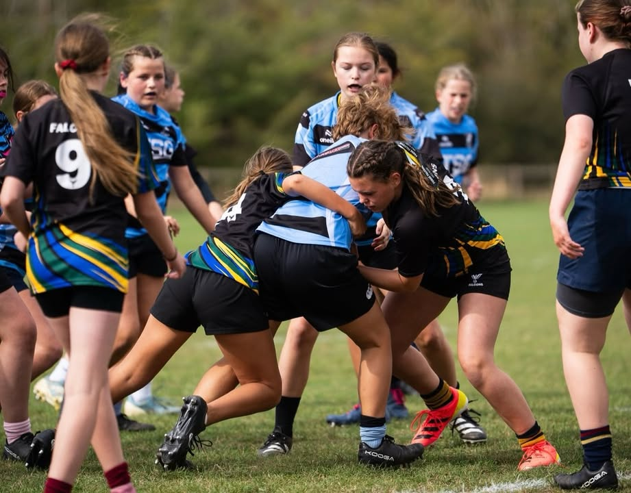
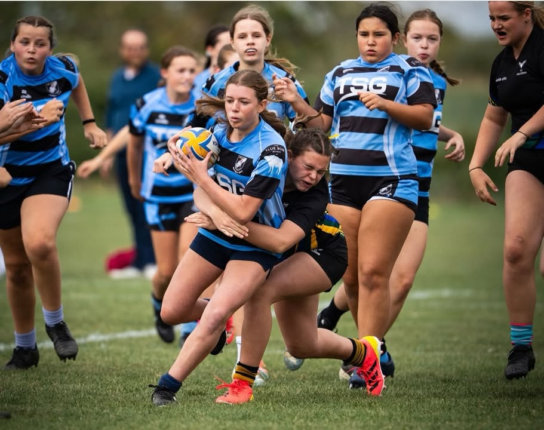
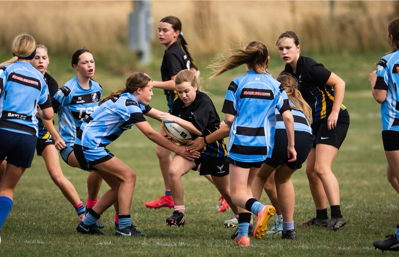
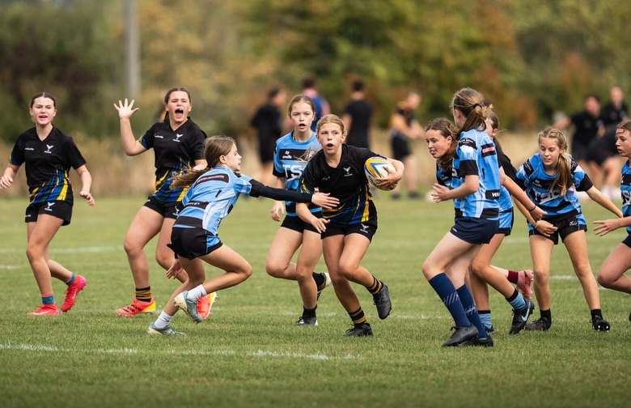
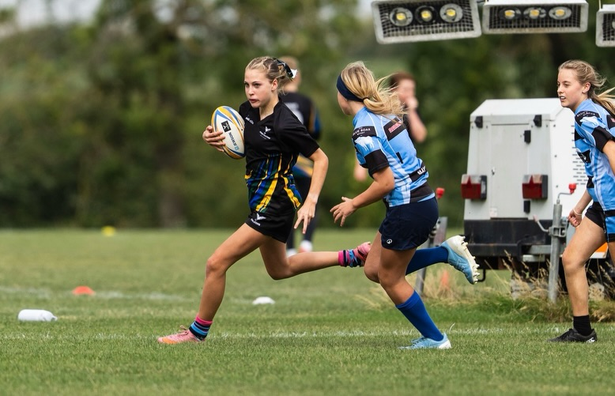
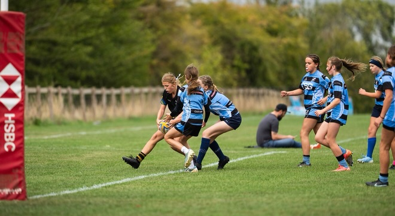
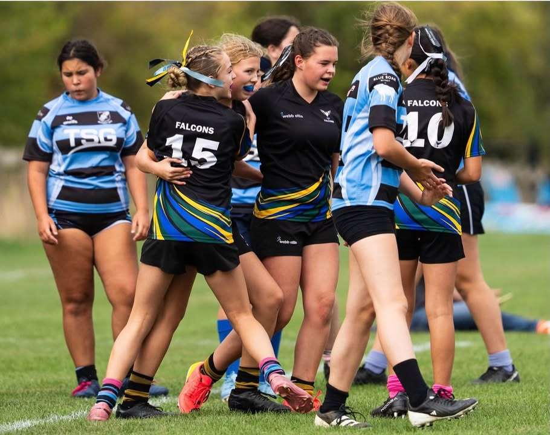
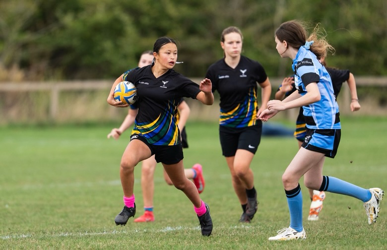
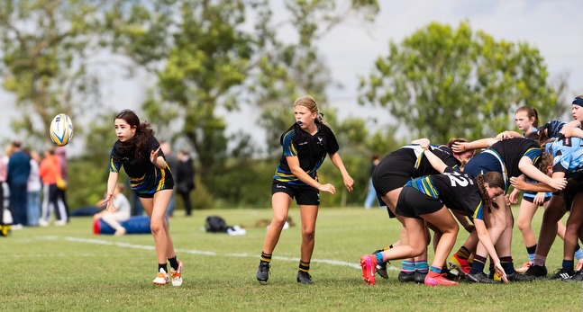
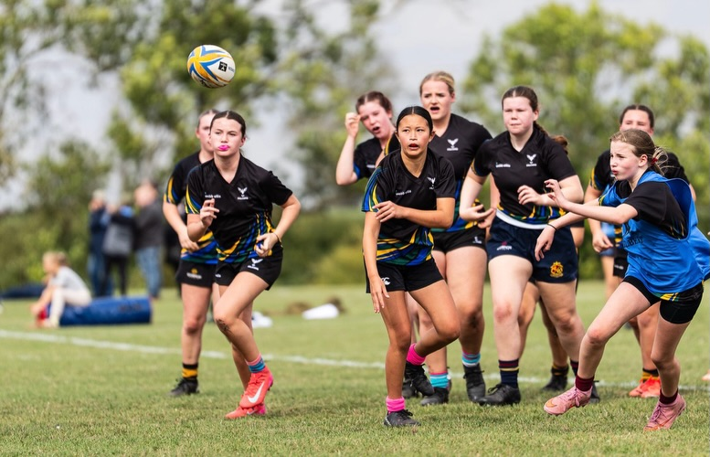
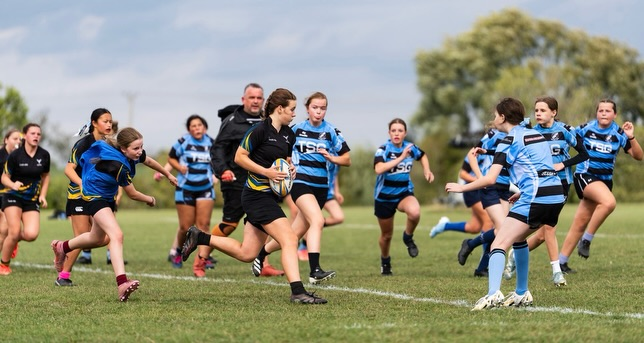

[Originally published on Facebook](https://www.facebook.com/122299632716035956/posts/122295994016035956).
