U16s…LEAGUE WIN&#33;   
  
Fosse welcomed Melkham Girls Rugby to Trinity Guild on Sunday for their first league game of the season  
  
Playing 11&#45;a&#45;side against an injury hit Melkham&#44; a fiercely contested first half saw Fosse use their power up front before releasing the backs into space&#44; taking a 29–20 lead at half&#45;time  
  
Unfortunately&#44; 2 further injuries left Melkham with only 9 fit players&#44; meaning the league fixture was called at half&#45;time&#44; giving Fosse the win and a 4 try bonus point  
  
The girls carried on with a friendly second half with plenty more attacking rugby with the game finishing 41–32  
  
Players’ Player – Lilly with 3 tries  
Coaches’ Player – Ines with 2 tries  
  
A brilliant start to the league campaign&#33;   
  
We hope the injured Melkham players are recovering well  
  
A big thank you to Ken Pinfold at Leamington RFC for the fantastic photos 📸  
  
&#35;FosseFalcons &#35;GirlsRugby &#35;U16Rugby &#35;GrassrootsRugby &#35;WarwickshireRugby

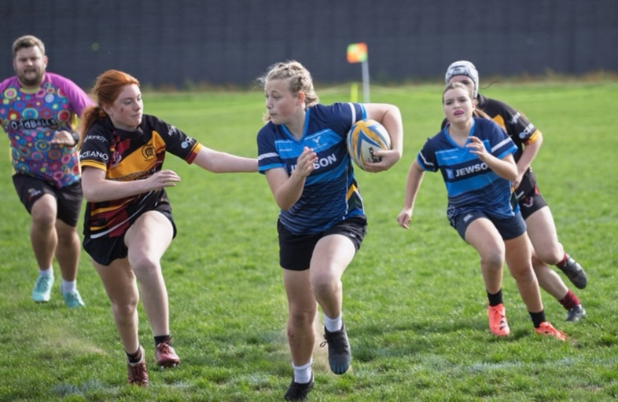
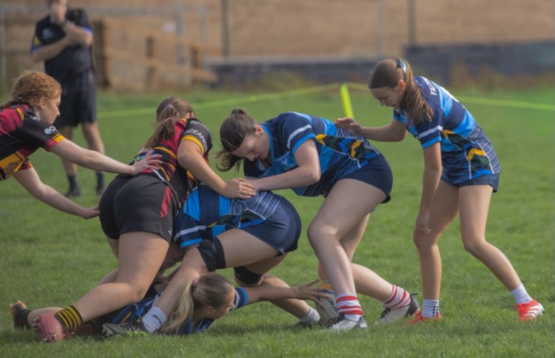
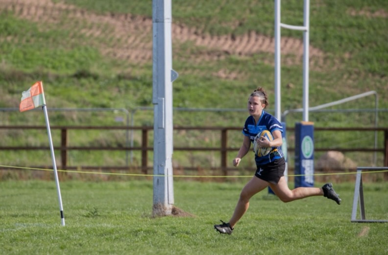
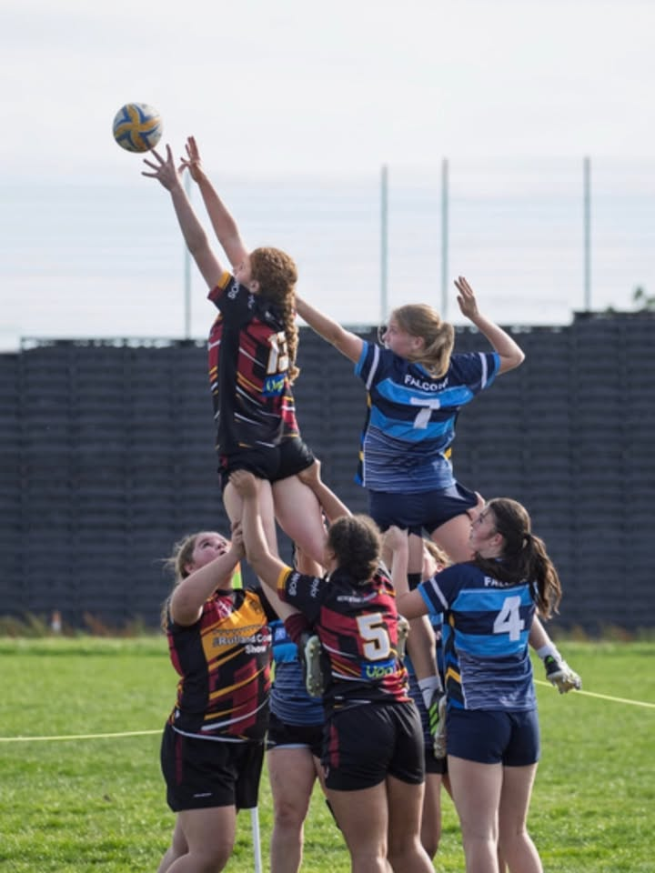
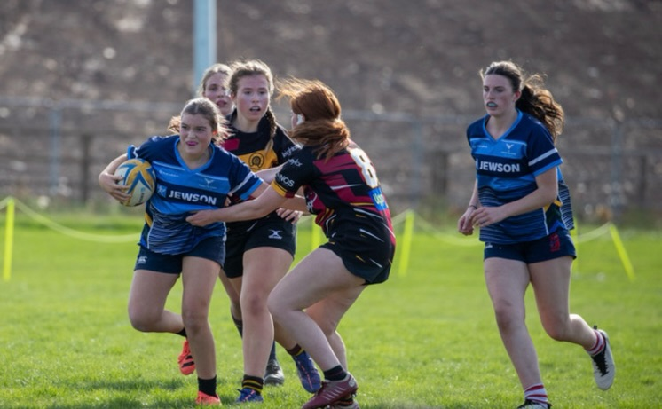
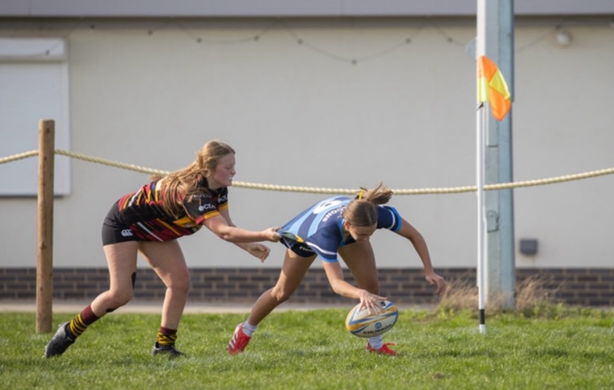
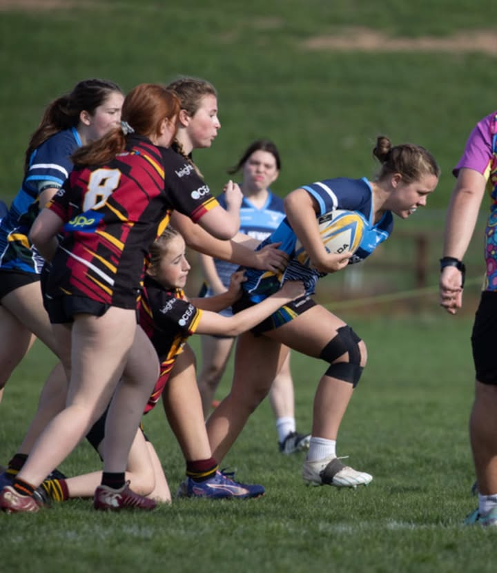
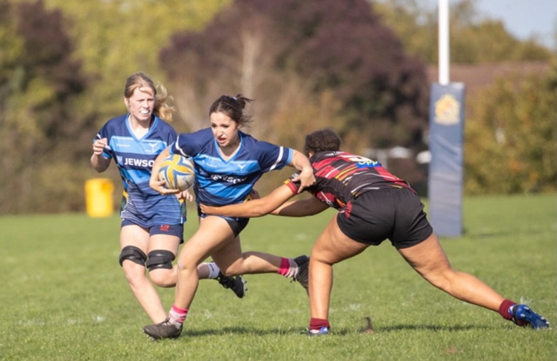
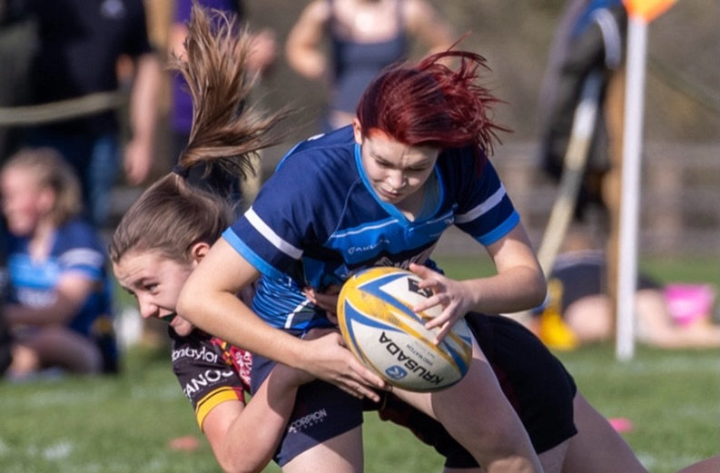
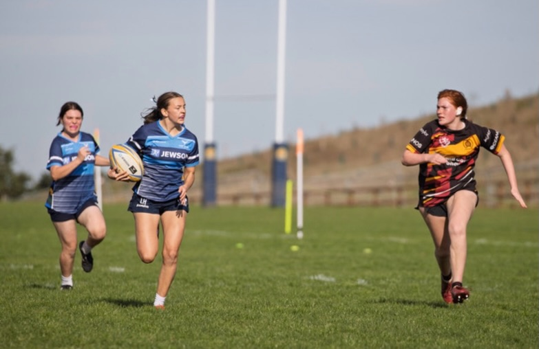
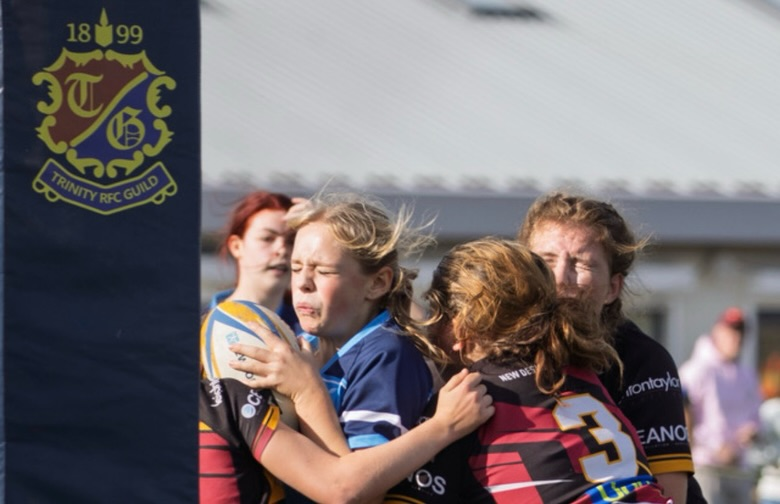
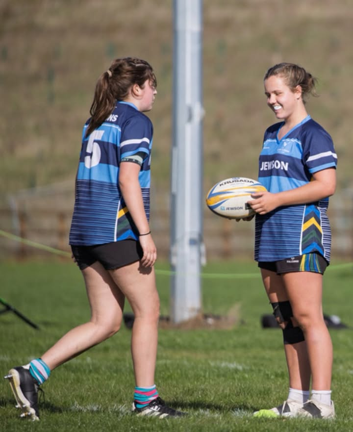

[Originally published on Facebook](https://www.facebook.com/122299632716035956/posts/122296418582035956).
