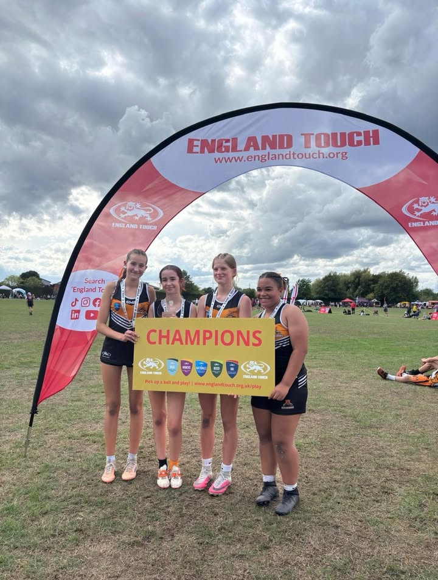
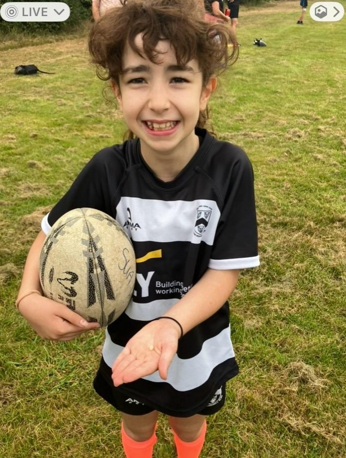
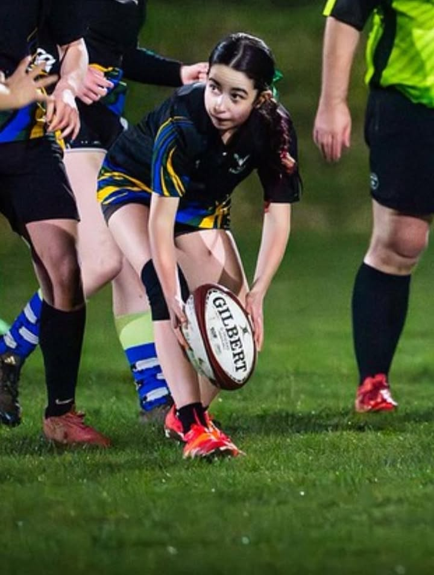
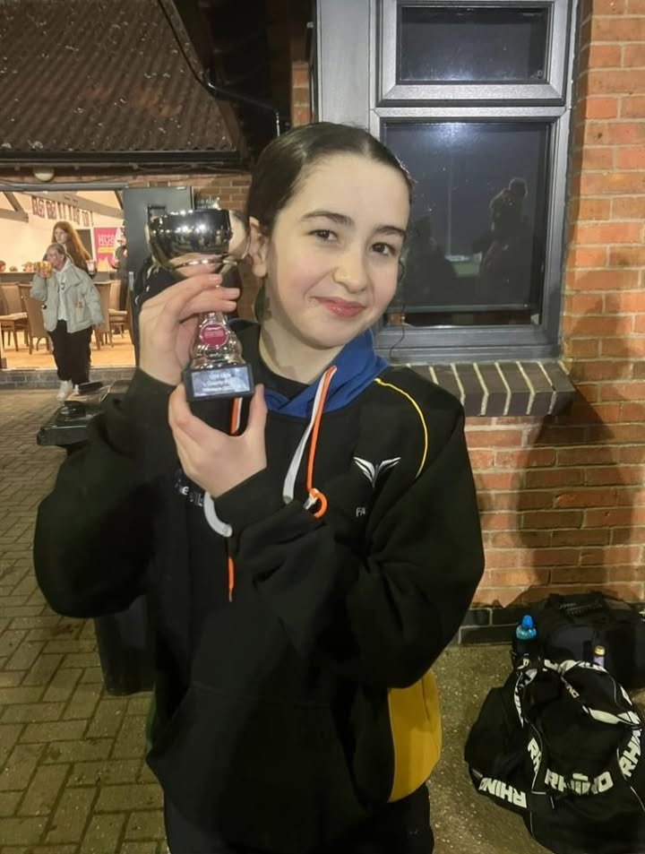
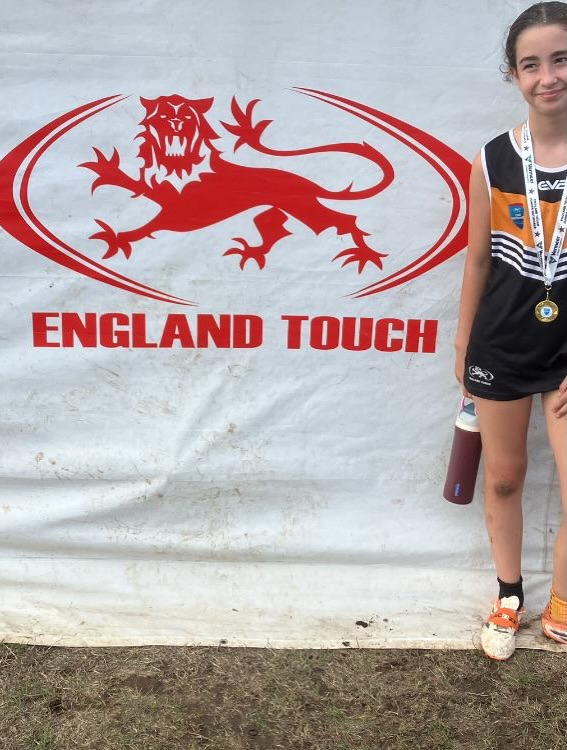
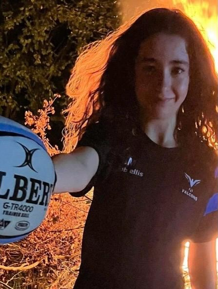

More than a rugby player &#124; touch &#38; contact  
  
Our ‘more than a rugby player’ series is back&#33;  
  
This time we’re celebrating one of our U14s&#44; whose rugby journey has taken her from her first touch rugby sessions at just 8 years old to becoming a National Touch Champion&#33;   
  
And she’s proving that girls don’t have to choose between touch and contact rugby&#44; there’s room to love &#38; play both&#33;   
  
Swipe through to follow her rugby journey&#33; 👉  
  
&#35;MoreThanARugbyPlayer &#35;FosseFalcons &#35;GirlsRugby &#35;TouchRugby &#35;GirlsInSport

[Originally published on Facebook](https://www.facebook.com/122299632716035956/posts/122296694102035956).
