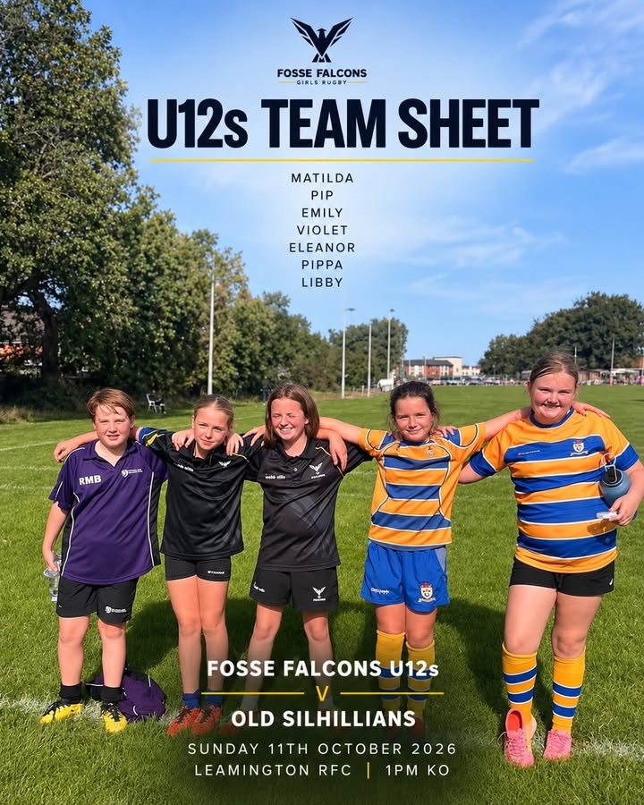
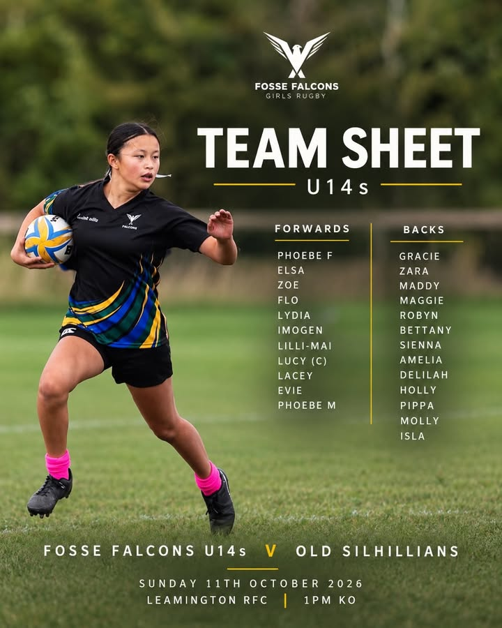
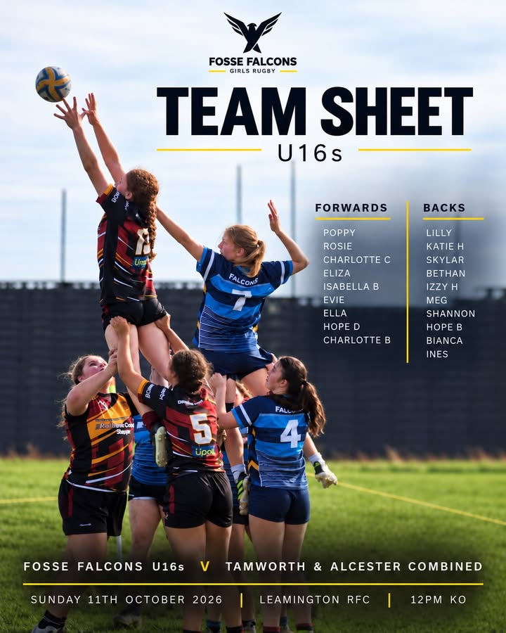
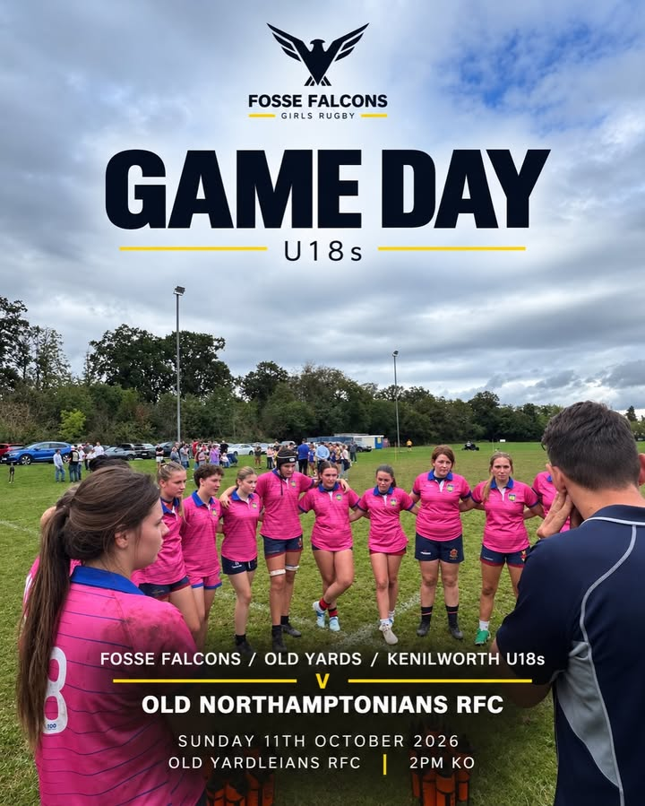

&#42;&#42;edit &#45; please note the U12 &#38; U14 KO time is 2pm&#33;&#42;&#42;  
  
4 age groups &#38; 1 Sunday filled with rugby&#33;   
  
A busy day ahead for Fosse Falcons tomorrow&#44; with all 4 age groups in action&#33;  
  
From our U12s through to our U18s&#44; it’s great to see so many of our girls taking to the pitch this weekend&#33;   
  
U12s v Old Sils  
Leamington RFC &#45; 2pm KO  
  
U14s v Old Sils  
Leamington RFC &#45; 2pm KO  
  
U16s v Tamworth &#38; Alcester  
Leamington RFC &#45; 12pm KO  
  
U18s v Old Northamptonians RFC  
Old Yardleians RFC &#45; 2pm KO  
&#40;Fosse Falcons &#47; Old Yards &#47; Kenilworth Combined&#41;  
  
There’s so much that goes on behind the scenes to make weekends like this happen&#46; From coordinating fixtures and players across clubs to organising pitches&#44; coaches and volunteers&#46; A huge thank you to everyone who puts in the time and effort to ensure our girls have the opportunity to get out there and play 🙌  
  
&#35;FosseFalcons &#35;GirlsRugby &#35;GrassrootsRugby &#35;GirlsInSport &#35;WarwickshireRugby

[Originally published on Facebook](https://www.facebook.com/122299632716035956/posts/122296960496035956).
