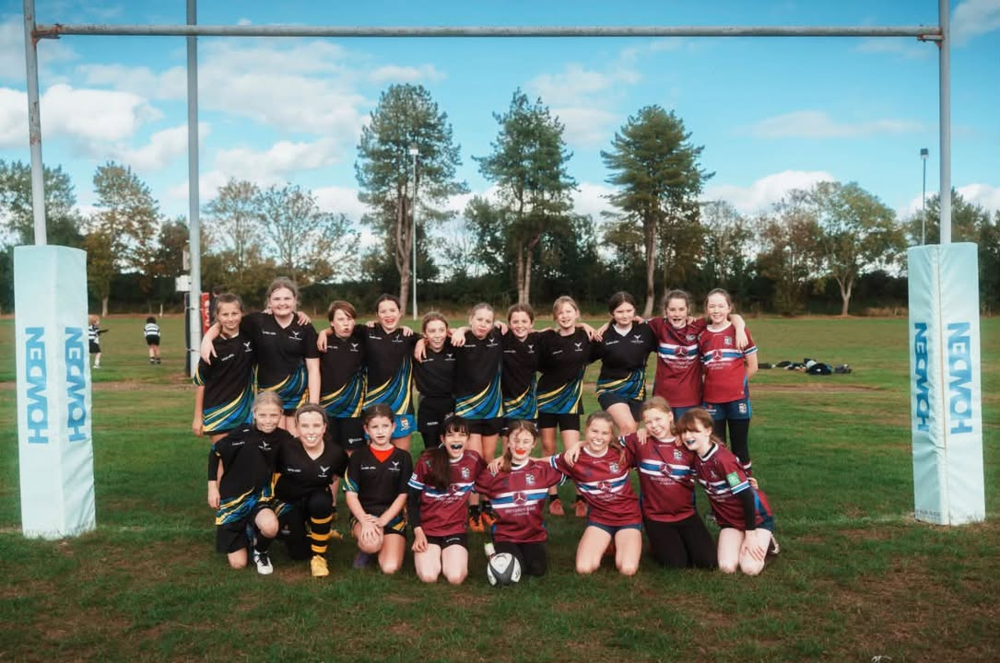

A brilliant effort from our Fosse Falcons U12s on Sunday against Sils Sirens&#33;  
  
For a team that only came together this season&#44; with many of the girls having never played rugby before&#44; it’s fantastic to see how far they’ve already come&#33;   
  
⭐ Matilda – Parents’ player of the match  
⭐ Eleanor – Opposition player of the match  
  
A special mention to Emily… we are all wishing you a speedy recovery&#33;   
  
A huge thank you to Sils Sirens for a great afternoon of rugby&#44; to all the parents for their support and to our coaches for everything they’re doing to help this new team grow&#46;  
  
Lots to be proud of&#44; girls&#33;  
  
&#35;FosseFalcons &#35;GirlsRugby &#35;GrassrootsRugby &#35;GirlsInSport &#35;WarwickshireRugby

[Originally published on Facebook](https://www.facebook.com/122299632716035956/posts/122297570924035956).
