U14s Fosse Falcons 17–17 Sils Sirens 11&#47;10&#47;26  
  
A hard fought draw for our U14s on Sunday&#44; with plenty of positives to take from a competitive afternoon of rugby  
  
3 tries from Robyn&#44; Molly and Isla&#44; with Amelia adding the conversion&#44; saw Fosse finish level at 17–17  
  
Our captain for the day&#44; Lucy&#44; reflected on some of the team’s strengths&#44; highlighting their tackling&#44; scrummaging&#44; organisation and determination to win back possession  
  
She also gave special mentions to&#58;  
  
⭐ Evie – for a brilliant try saving tackle and some excellent chasing  
  
⭐ Phoebe F – for finding space and breaking through the defensive line  
  
⭐ Maggie – for her work at the rucks and jackaling to regain possession  
  
Lucy also identified areas to work on&#44; particularly getting to the breakdown quicker and improving tackle technique  
  
A great example of the girls supporting one another&#44; recognising individual contributions and learning together as a team  
  
As Lucy put it&#58; “I love being part of the Under 14 Fosse Falcons&#33;”  
  
A selection of moments from Sunday’s match&#44; captured by the brilliant  Tim Hearn   
  
&#35;FosseFalcons &#35;GirlsRugby &#35;U14Rugby &#35;GirlsInSport &#35;GrassrootsRugby

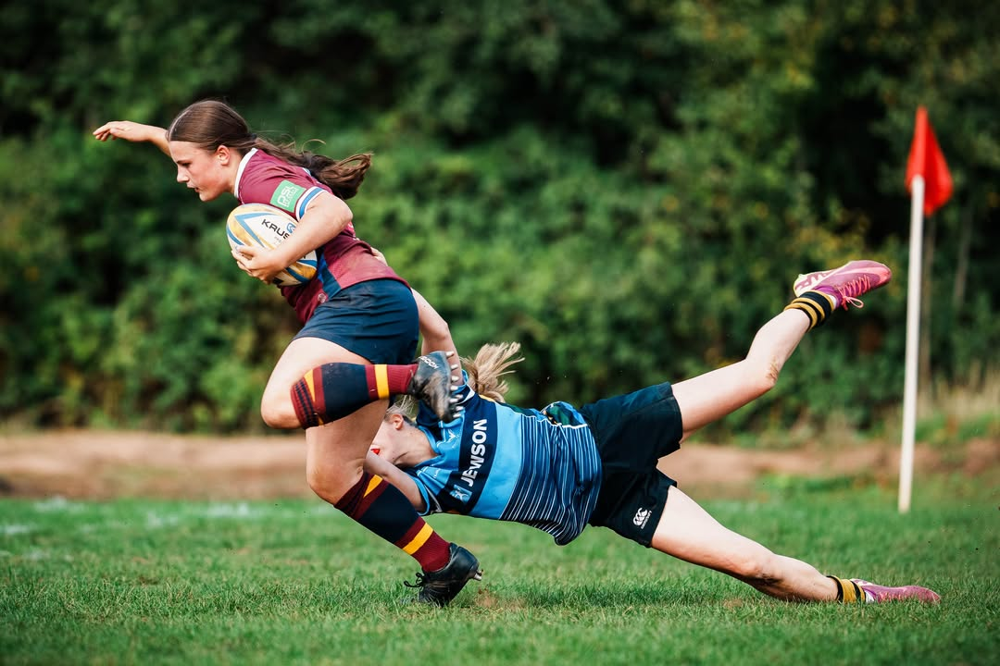
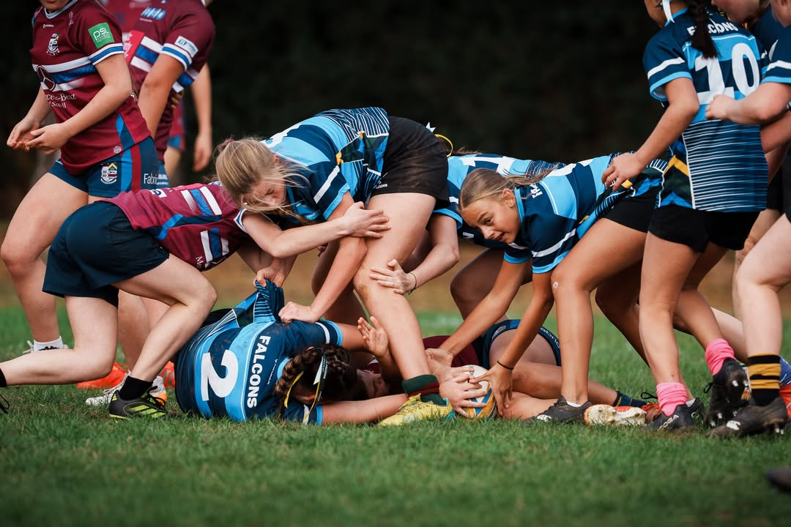
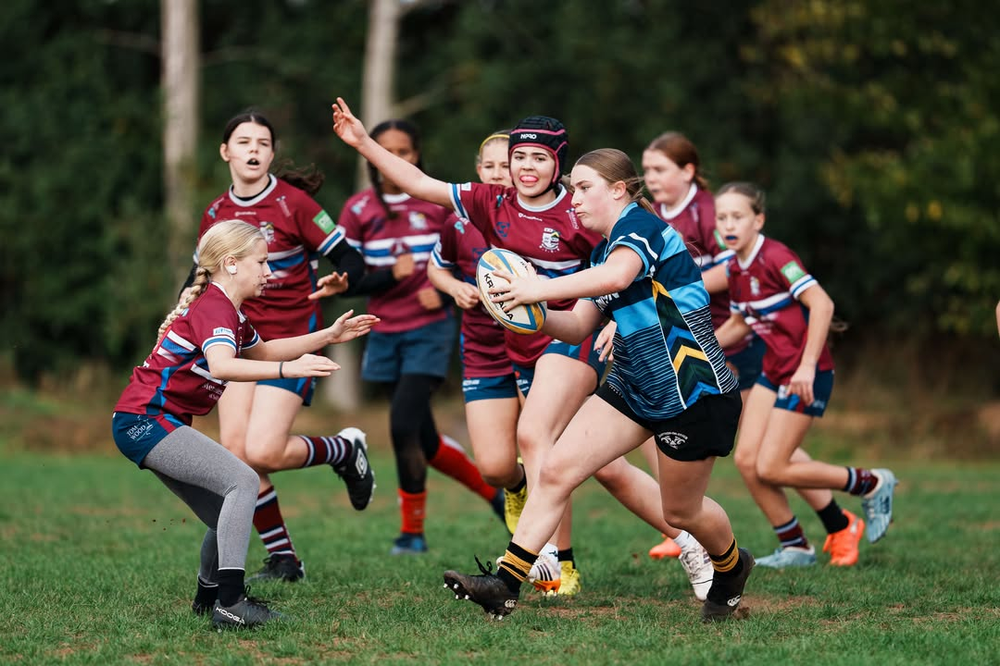
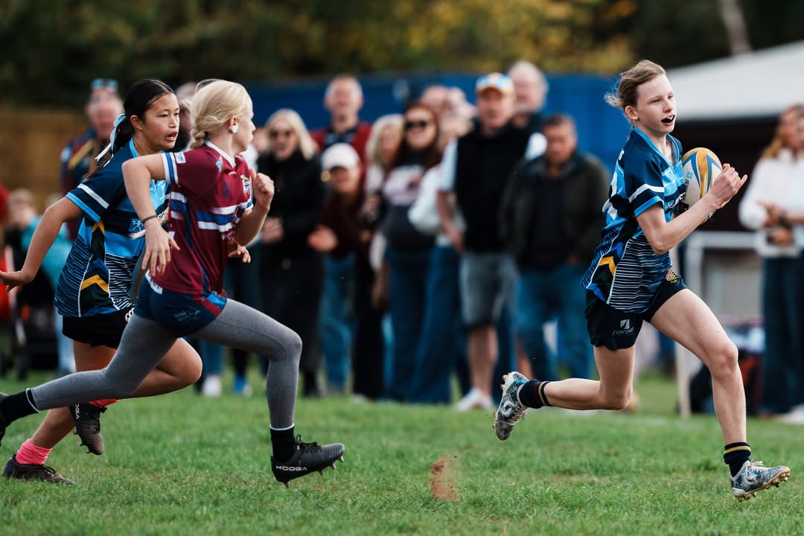
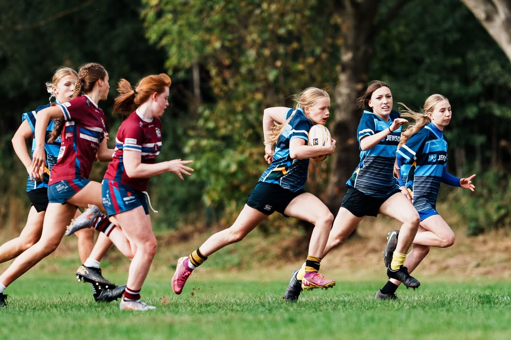
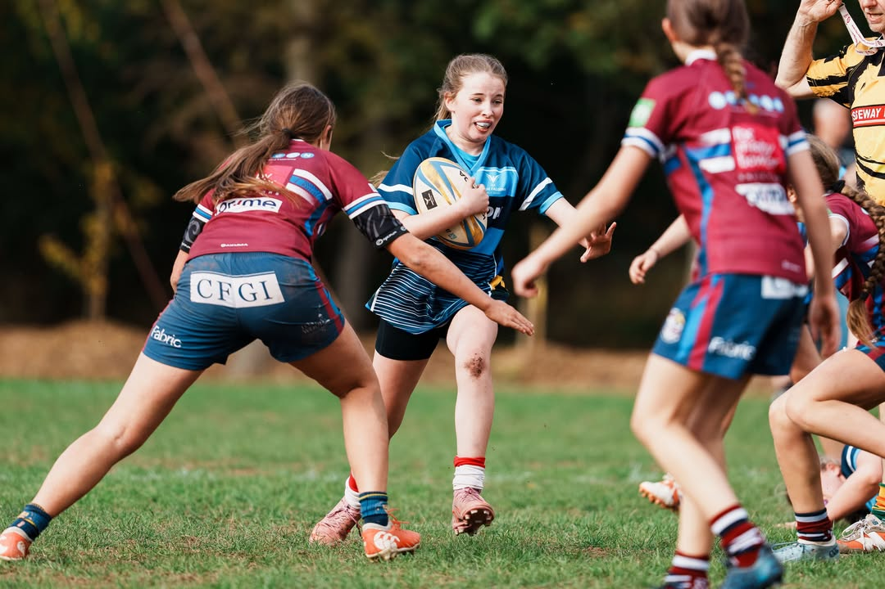
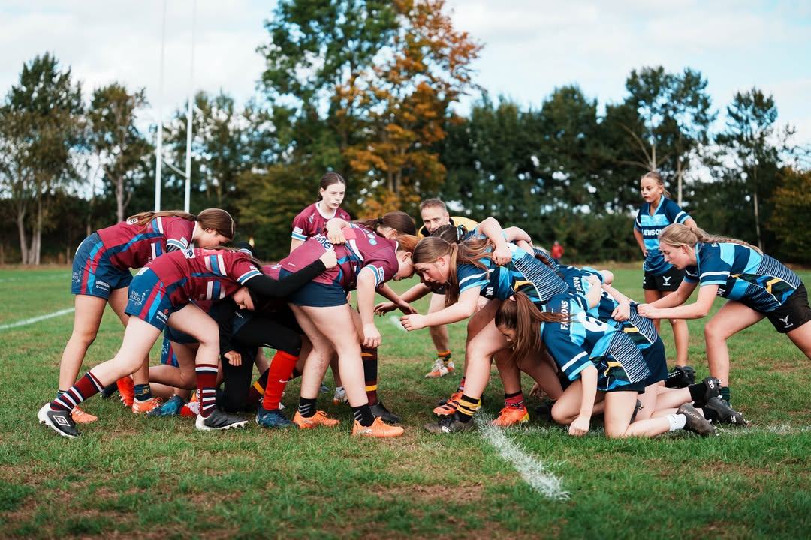
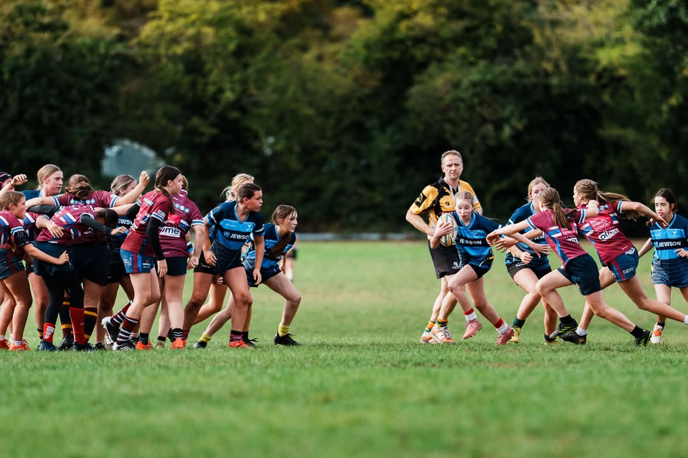
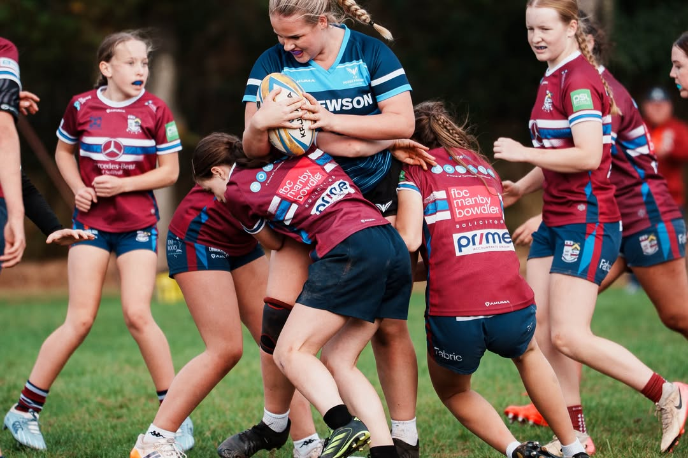
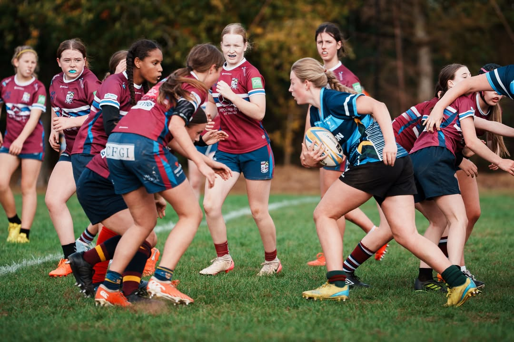
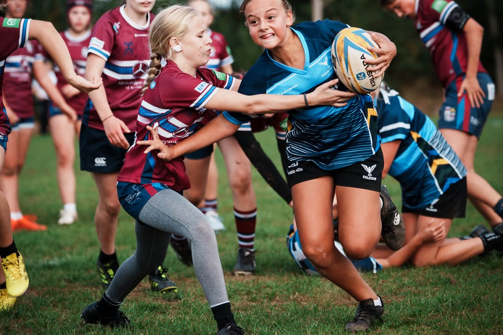
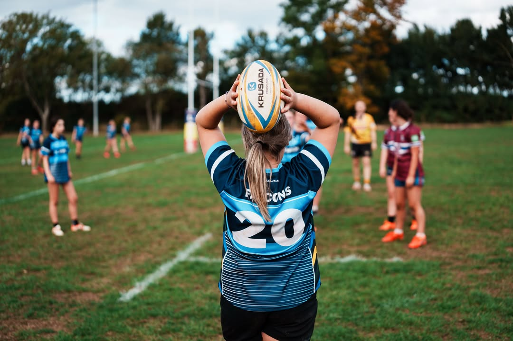

[Originally published on Facebook](https://www.facebook.com/122299632716035956/posts/122297805362035956).
