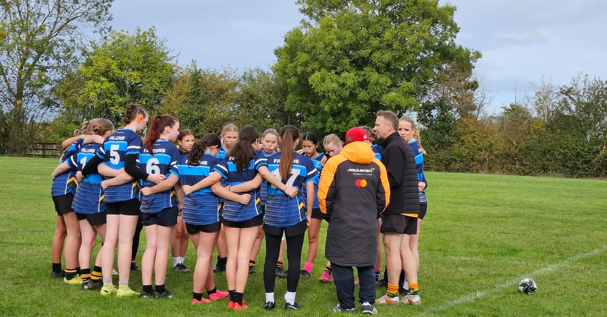
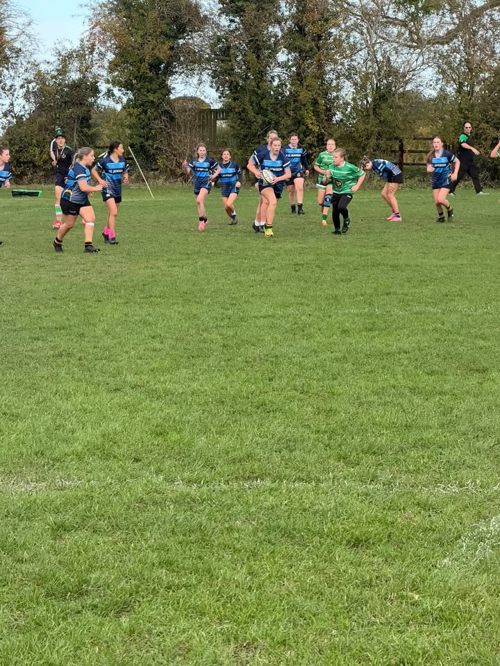
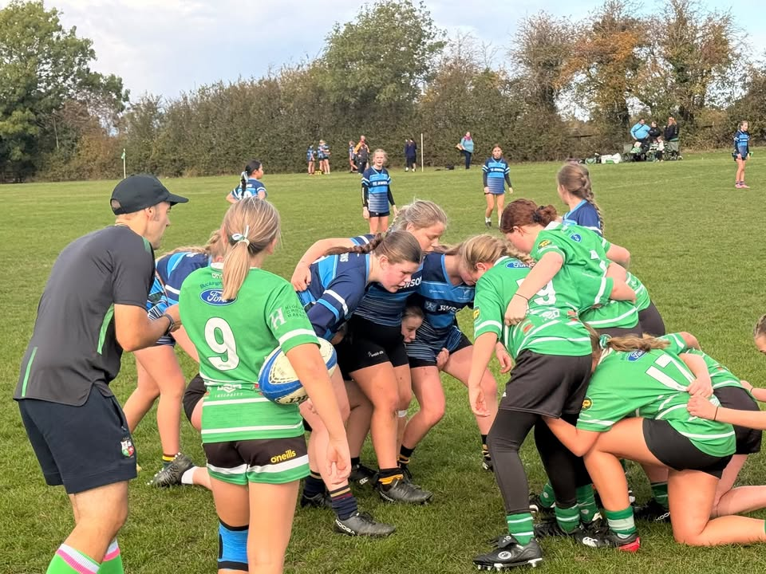
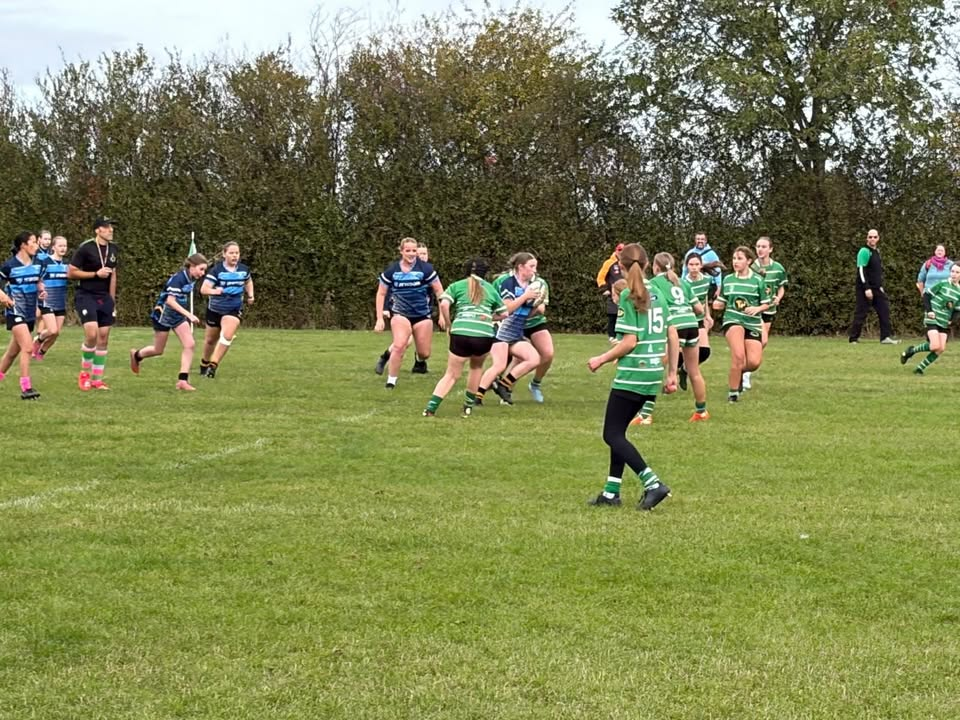
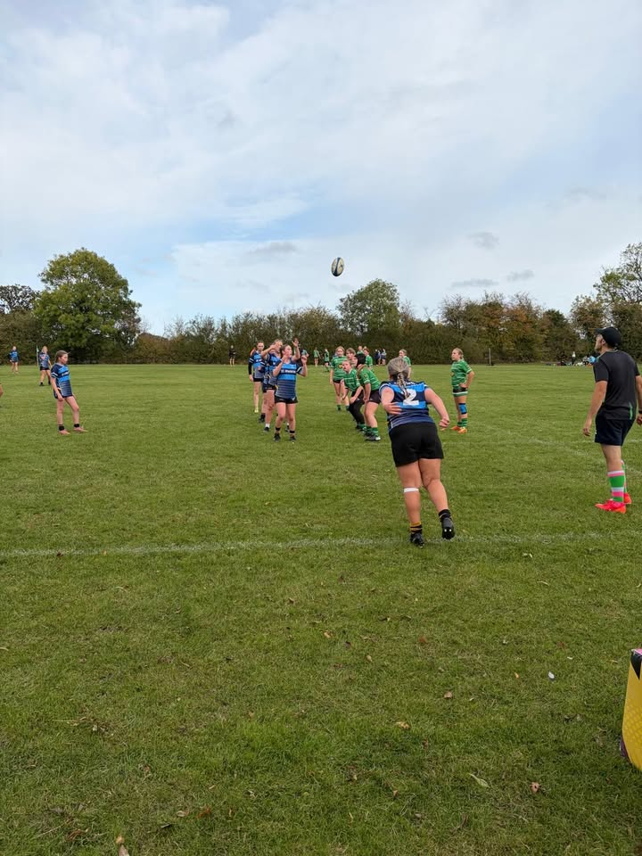
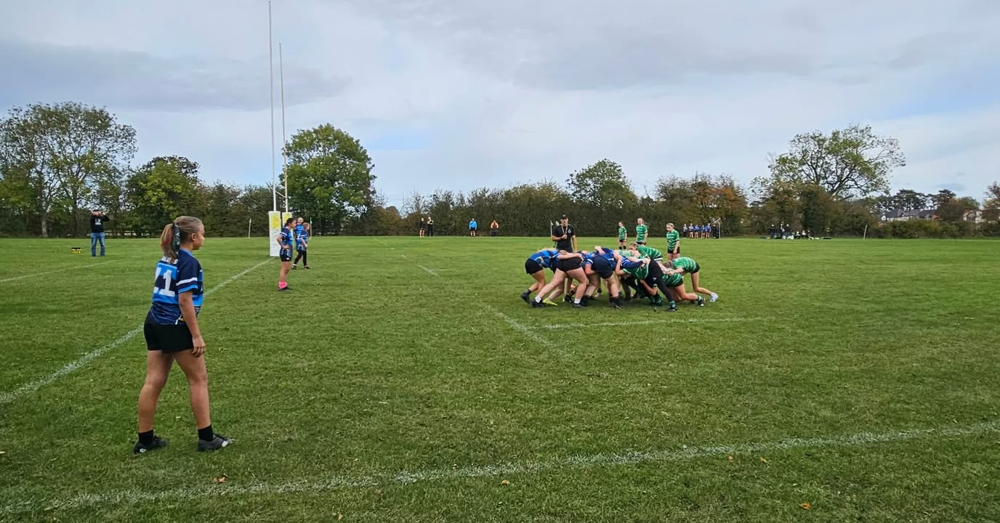
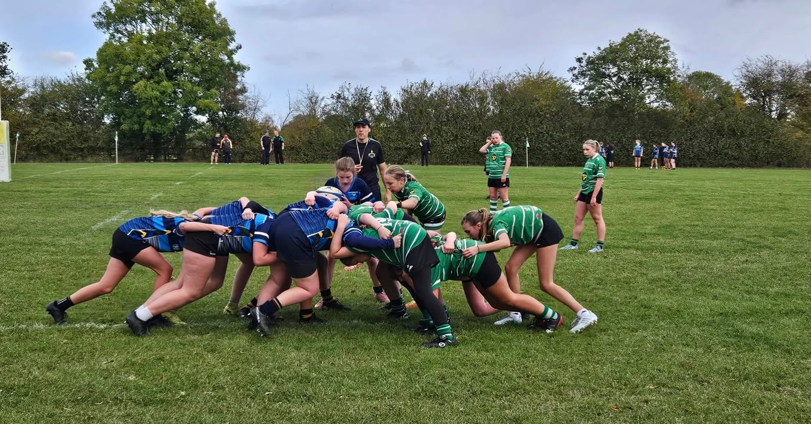

U14s &#45; Fosse Falcons v Buckingham  
  
Another determined performance from our U14s on Sunday&#44; with some strong tackling&#44; great work at the breakdown and plenty of teamwork across the pitch  
  
Molly crossed the line twice&#44; with Maddy adding another try and a conversion to bring Fosse’s total to 17  
  
With the scores tied at 17–17&#44; the match came to an early end when Buckingham were unable to field the minimum number of players required to continue&#46; Fosse were subsequently awarded the win under the league rules  
  
Captain Lilli&#45;Mai’s shout outs went to Molly for her powerful runs and line breaks&#44; Flo for her excellent rucking and jackaling&#44; and Holly for some brilliant tackles out on the wing&#46;  She also highlighted the way the more experienced girls supported the newer players throughout the game  
  
Plenty of positives to take away&#33; Well played&#44; girls&#44; and thanks to Buckingham for a great game&#33;  
  
&#35;FosseFalcons &#35;GirlsRugby &#35;U14Rugby &#35;GirlsPlayRugbyToo &#35;BucksLeague

[Originally published on Facebook](https://www.facebook.com/122299632716035956/posts/122298213362035956).
