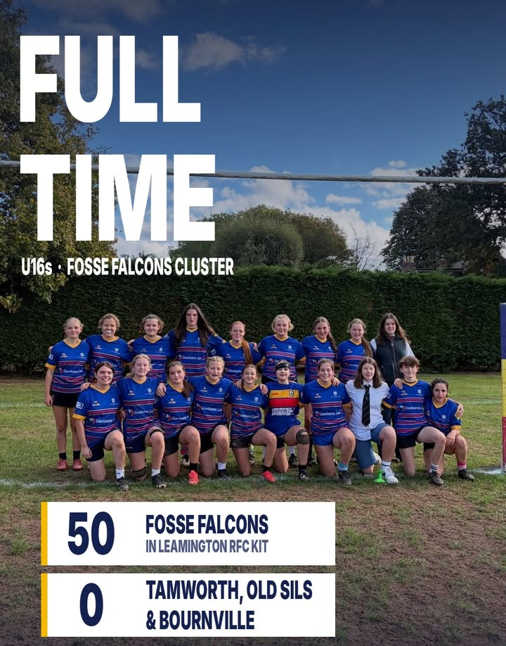
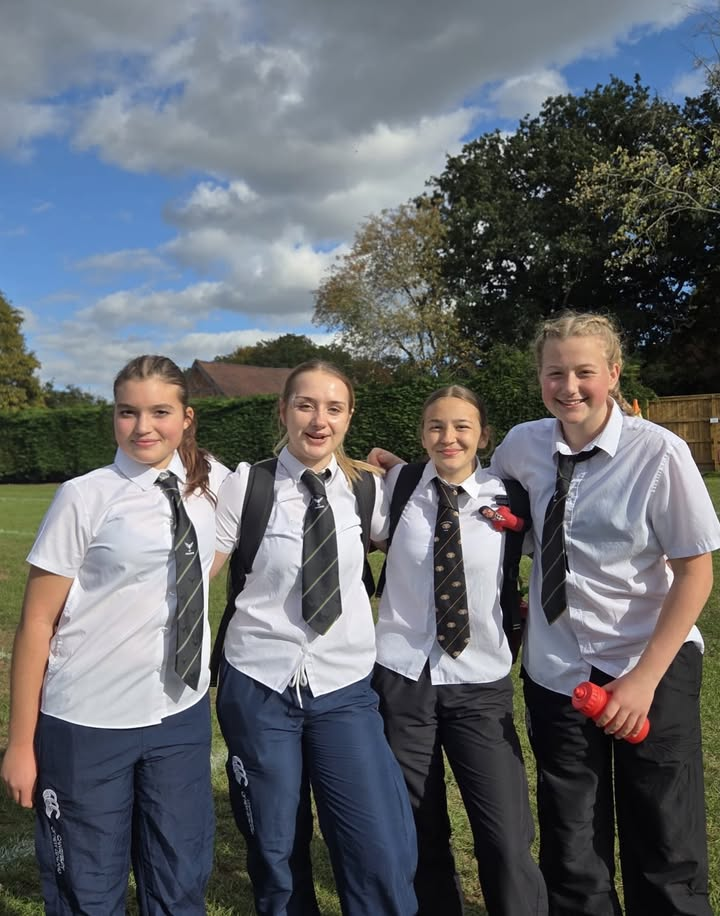

Fosse Falcons 50–0 Tamworth&#44; Old Sils &#38; Bournville  
  
Despite changes to the side &#40;Rosie at hooker&#44; Poppy’s first start at prop&#44; Ella throwing in at the lineout&#41;&#44; the Fosse girls started strongly&#46; Big defence from Hope&#44; Lilly&#44; Ella&#44; Eliza and Rosie gave the backs a platform&#44; and Skylar&#44; Ines&#44; Izzy and Katie made big ground&#46; The visitors made us work to the final whistle&#44; so the scoreline doesn’t tell the full story&#46;  
  
Coaches’ player&#58; Evie&#44; who worked tirelessly and scored her first try  
  
First try for Ella too&#33;  
  
Players’ player&#58; Skylar&#44; who came back after a bang of heads with a bandage on and played brilliant heads&#45;up rugby  
  
Proudly wearing the Leamington RFC kit   
💙💛❤️  
  
&#35;FosseFalcons &#35;LeamingtonRFC &#35;U16sRugby &#35;GirlsRugby &#35;WarwickshireRugby

[Originally published on Facebook](https://www.facebook.com/122299632716035956/posts/122297329832035956).
