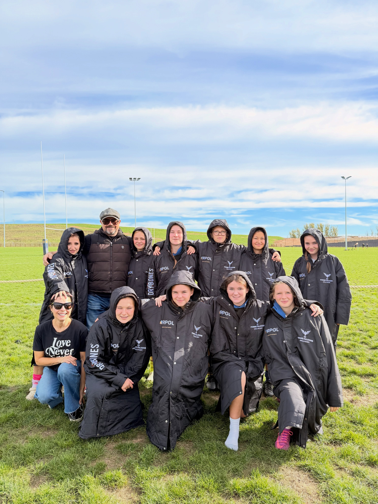
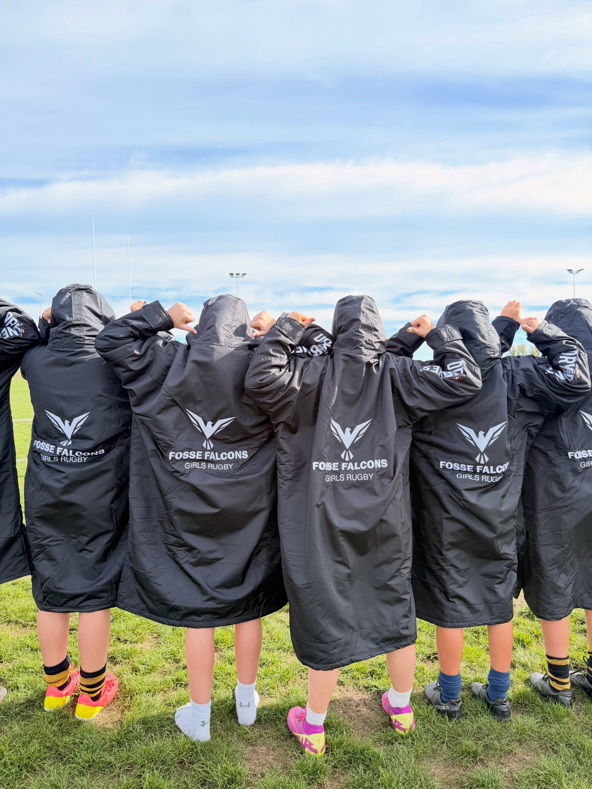
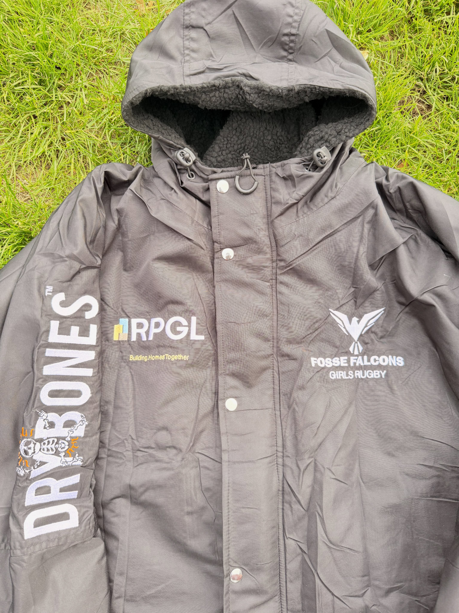

---
title: "New Kit Alert"
description: "Fosse Falcons thank Warwickshire property developer RPGL for sponsoring new DRYBONES sub coats to help keep our girls rugby players warm."
date: 2026-10-05
tags: [sponsor]
---

### A big thank you to RPGL for sponsoring our new DRYBONES sub coats for the Fosse Falcons girls!

[RPGL](https://rpgl.co.uk/) is a Warwickshire based property development business delivering residential led developments alongside projects across the hotel and student accommodation sectors. We’re really pleased to have the support of another local business backing grassroots girls’ rugby
Made by [DRYBONES](https://wearedrybones.co.uk/) the coats have been fully branded with Fosse Falcons and RPGL and we think they look pretty smart!

It’s still a little too warm to put them properly to the test but they’ll get plenty of use once the typical British winter kicks in! 🌧️

Thank you to [RPGL](https://rpgl.co.uk/) for supporting grassroots girls’ rugby, and to [DRYBONES](https://wearedrybones.co.uk/) for doing such a great job with the coats

