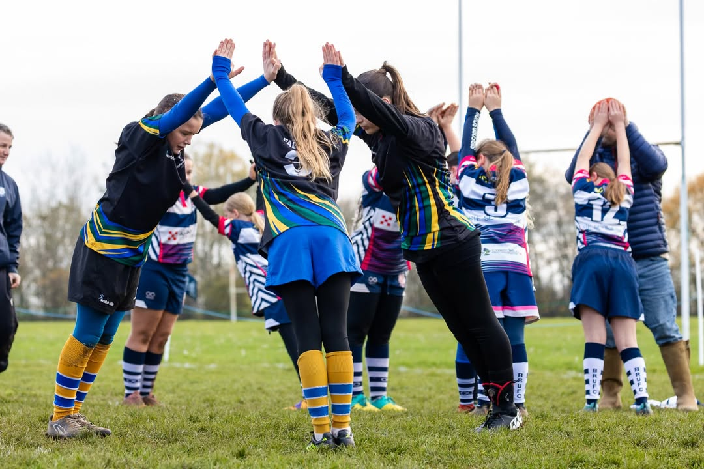
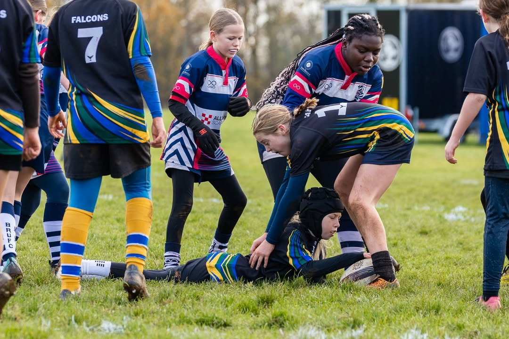
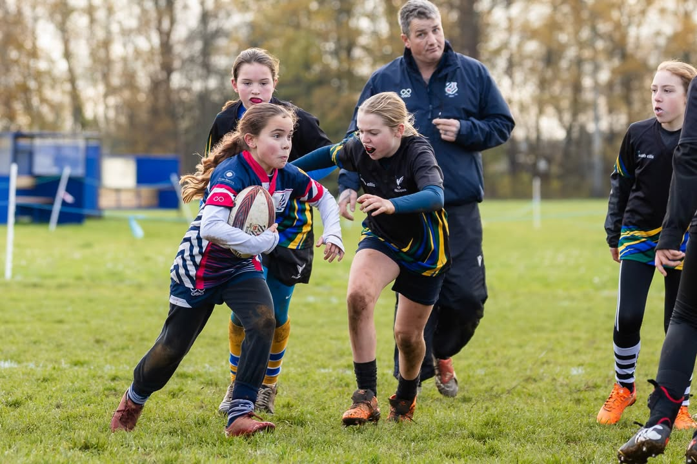
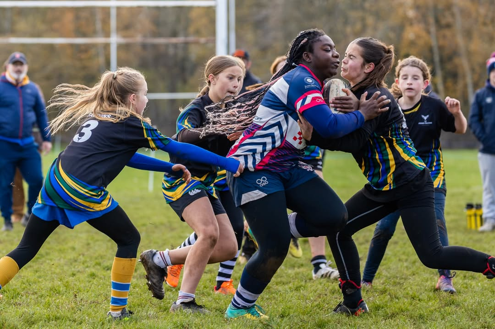
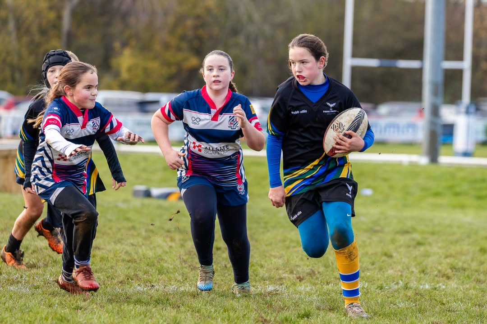
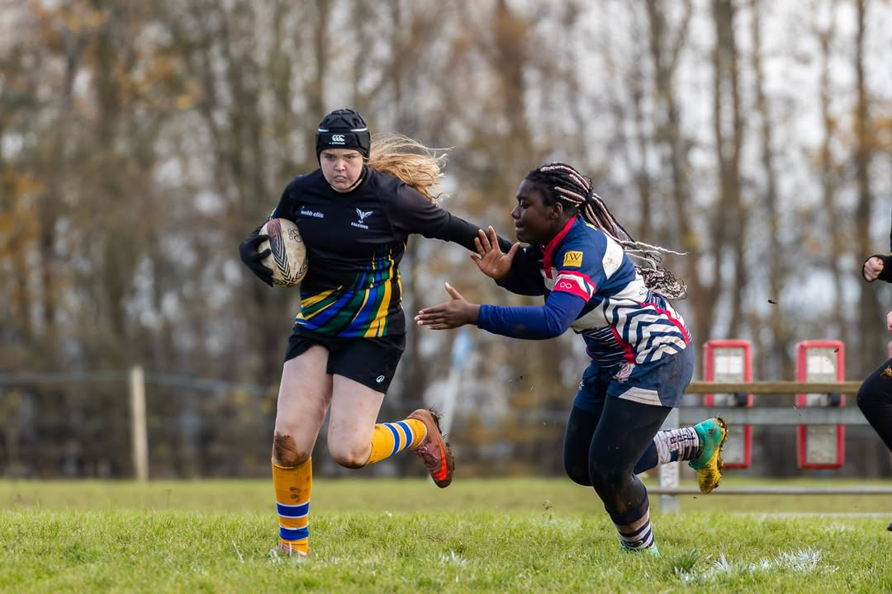
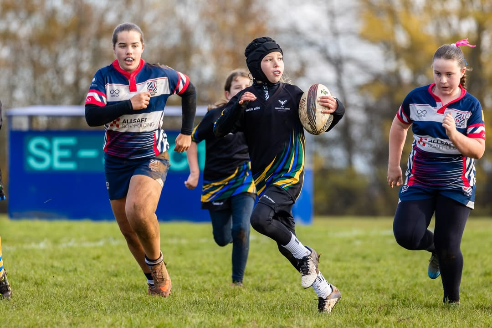
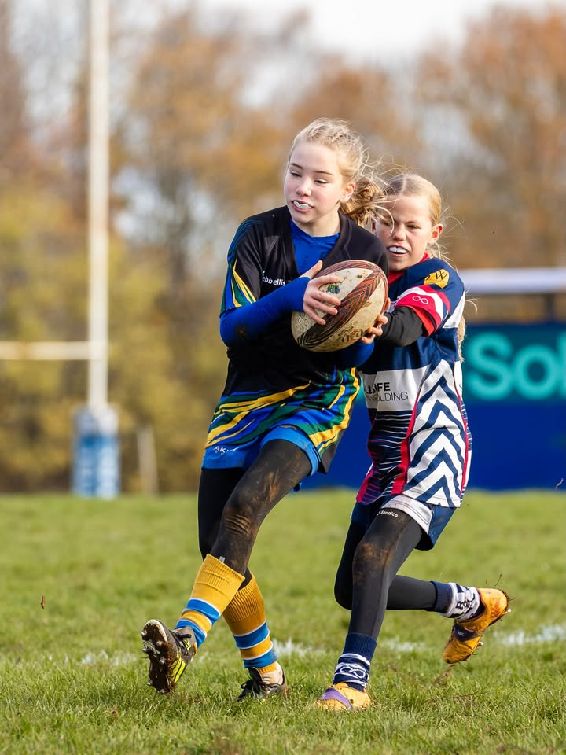
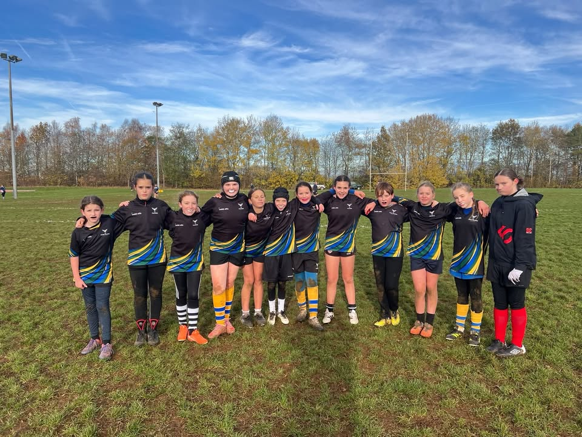
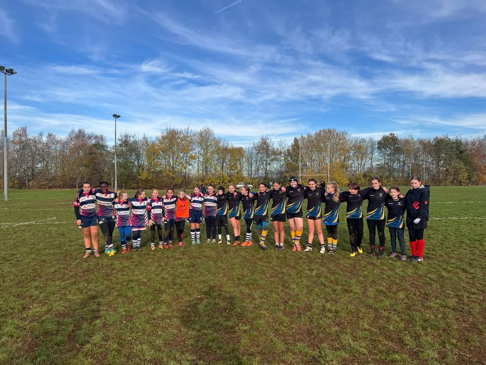

From coach Charlie “Banbury brought a physical game on a cold but sunny day&#46; The girls stuck at it&#44; worked well together and put together some good attacking play&#44; and they got more confident as the game went on&#46;  
  
It was great to have a few players back after injury and illness&#46; We learnt a lot&#44; and we’ve got plenty to take into training next&#46;  
  
Well done to Matilda&#44; the parents’ player of the match&#44; and to Libby&#44; who was named player of the match by the opposition” 🙌   
  
Thank you for hosting us Banbury Rugby Union Football Club Banbury Junior Belles   
  
&#35;GirlsRugby &#35;U12Rugby &#35;WarwickshireRugby &#35;BanburyRugby &#35;News

[Originally published on Facebook](https://www.facebook.com/122299632716035956/posts/122303382686035956).
