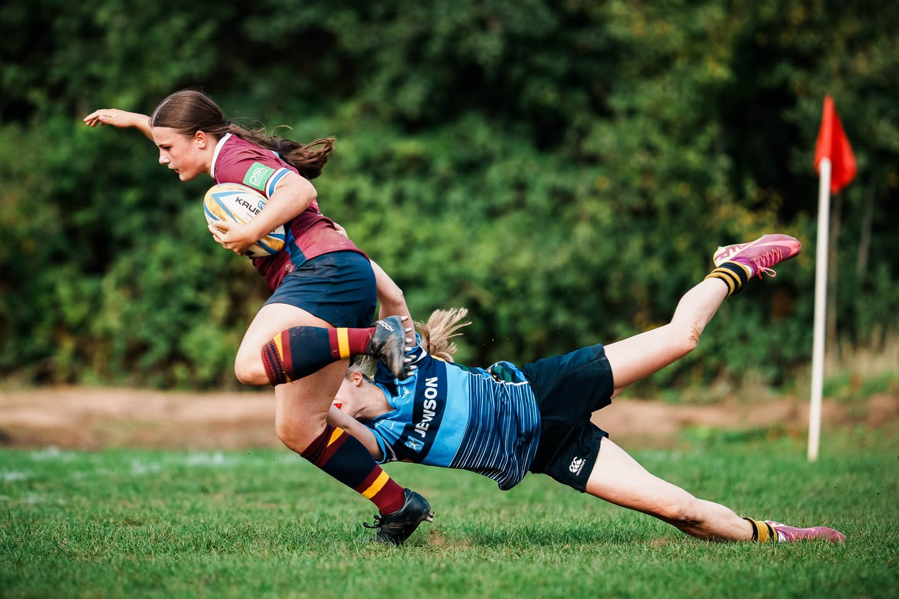
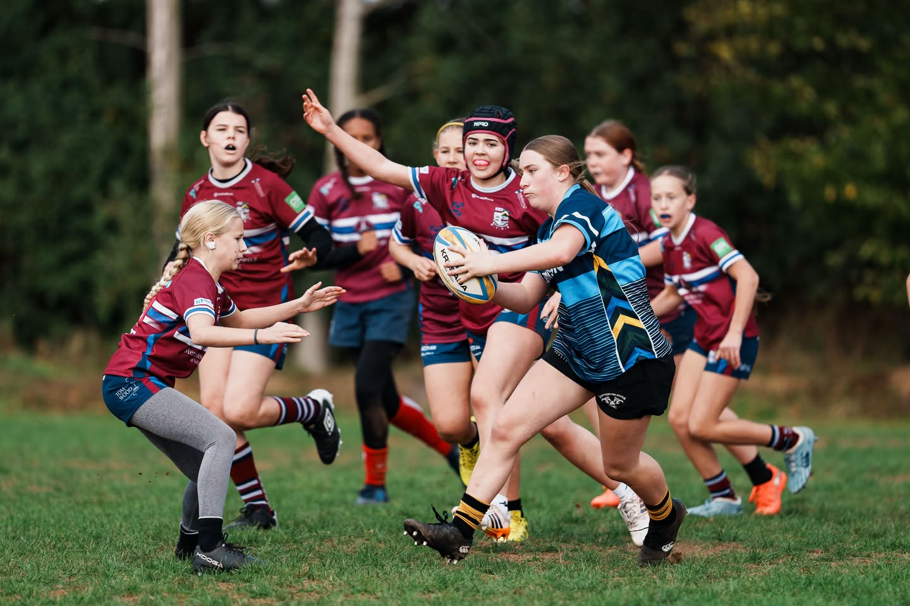
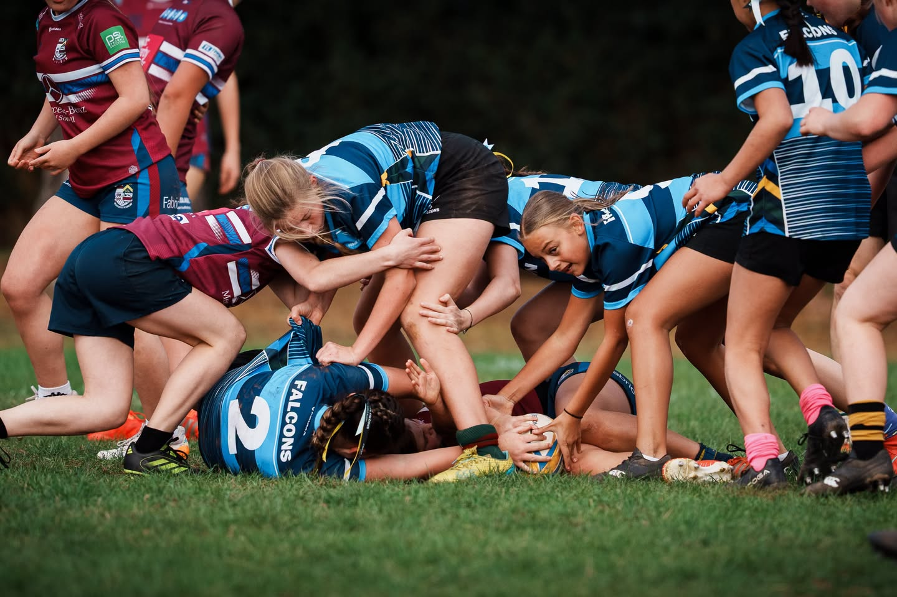
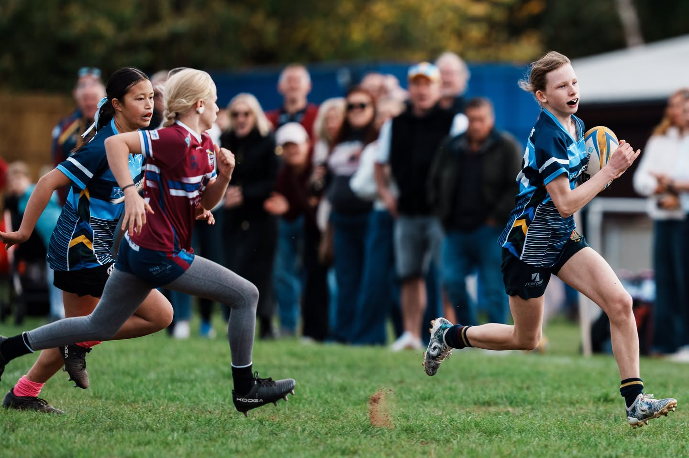

## U14s Fosse Falcons 17–17 Sils Sirens 11/10/26

A hard fought draw for our U14s on Sunday, with plenty of positives to take from a competitive afternoon of rugby.

3 tries from Robyn, Molly and Isla, with Amelia adding the conversion, saw Fosse finish level at 17–17
Our captain for the day, Lucy, reflected on some of the team’s strengths, highlighting their tackling, scrummaging, organisation and determination to win back possession.

She also gave special mentions to:
- ⭐ Evie – for a brilliant try saving tackle and some excellent chasing
- ⭐ Phoebe F – for finding space and breaking through the defensive line
- ⭐ Maggie – for her work at the rucks and jackaling to regain possession

Lucy also identified areas to work on, particularly getting to the breakdown quicker and improving tackle technique.

A great example of the girls supporting one another, recognising individual contributions and learning together as a team.

As Lucy put it: “I love being part of the Under 14 Fosse Falcons!”

A selection of moments from Sunday’s match, captured by the brilliant [Tim Hearn](https://www.instagram.com/timhearnphoto/)

