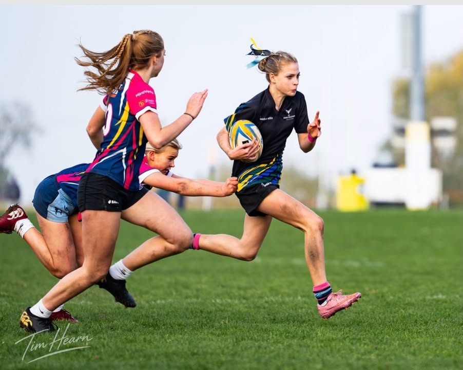
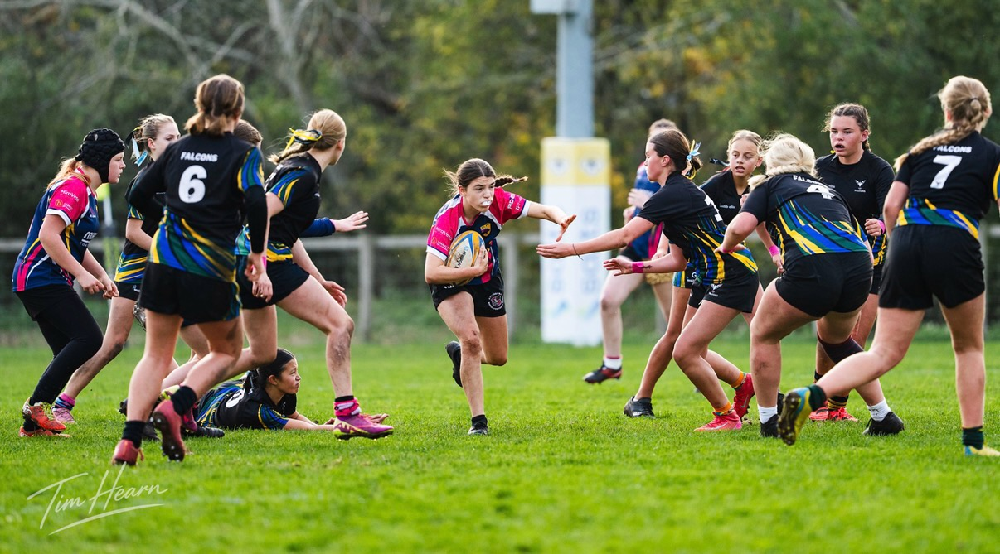
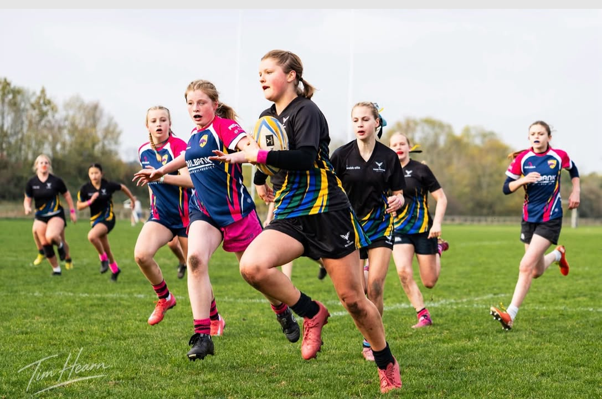
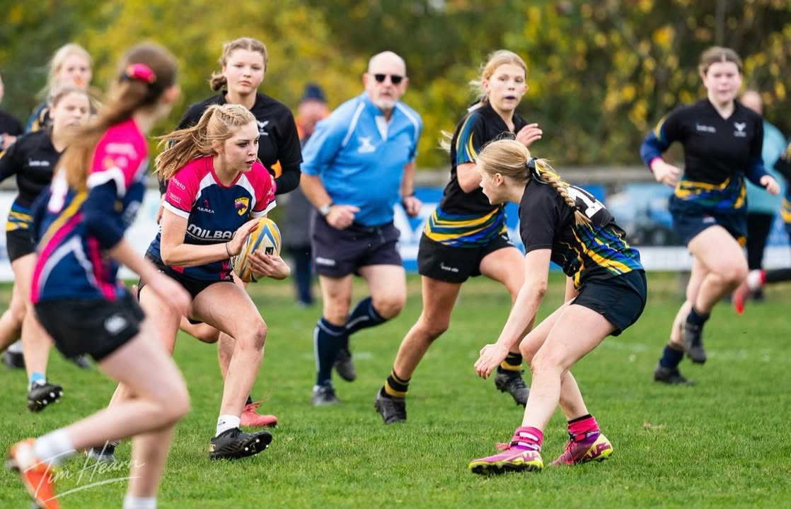
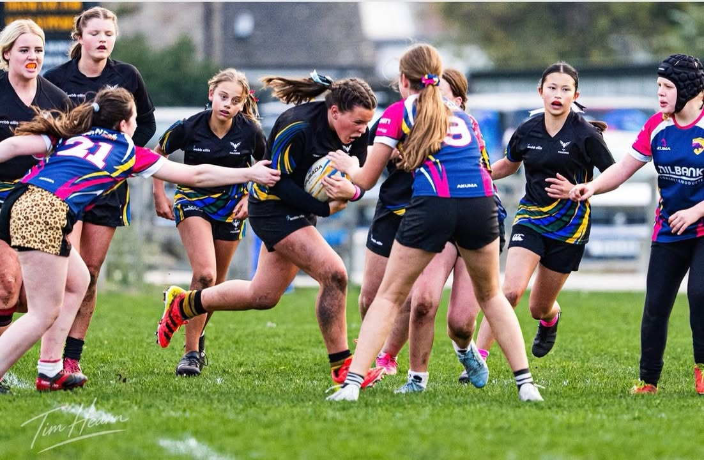
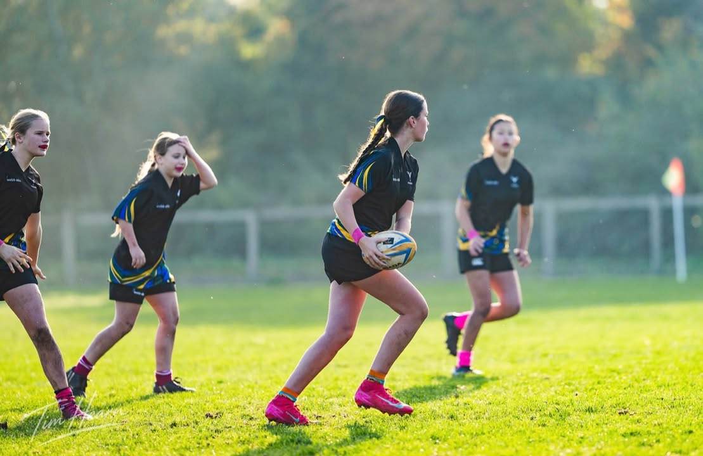
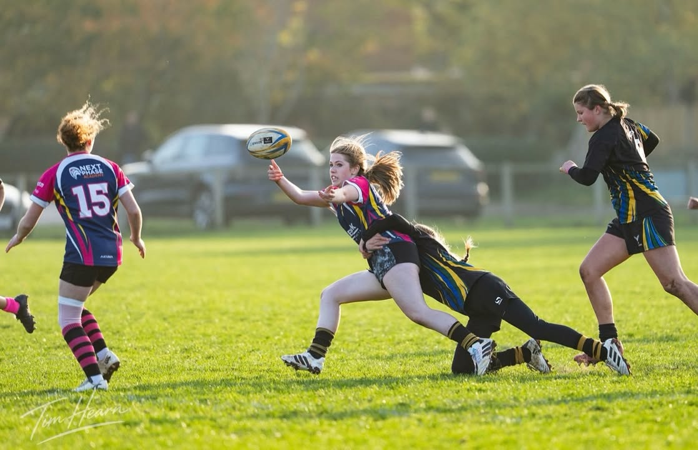
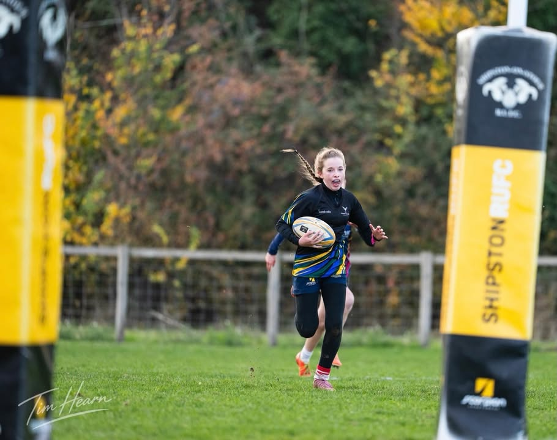
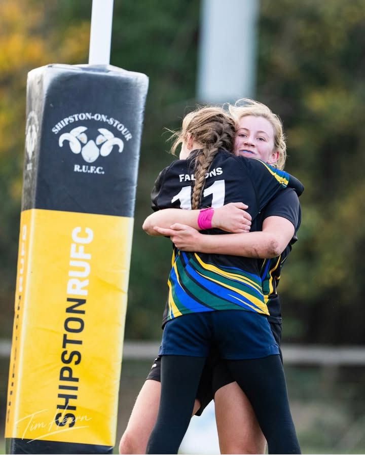

Another nail biter and another fantastic display of determination from our U14s&#33;  
  
A tough&#44; competitive match against a strong ATL side saw the Falcons battle back to secure a well&#45;deserved 24–24 draw on Sunday   
  
The girls showed real character&#44; growing stronger as the game progressed&#46; Improved communication&#44; better rucking and some brilliant attacking play showed just how much this squad is developing&#33;   
  
Our captain for the day&#44; Maggie&#44; summed it up perfectly&#58;  
  
“We showed great determination and teamwork to keep fighting right until the final whistle&#46;”  
  
Every match brings more confidence&#44; experience and progress&#33;  
  
Opposition player of the match &#45; Maddy&#33; 🤩  
  
Thanks to ATL for a great contest&#44; and best wishes to their injured player for a speedy recovery  
  
📸 Fantastic photos from Tim hearn capturing the action&#44; determination and team spirit&#33; If you’d like to purchase any photos&#44; head here https&#58;&#47;&#47;www&#46;timhearn&#46;uk&#47;Client&#45;Area&#47;Sports&#47;Rugby&#47;n&#45;NhZm5M&#47;Fosse&#45;Falcons&#45;v&#45;ATL to browse the full album  
  
&#35;FosseFalcons &#35;GirlsRugby &#35;U14Rugby &#35;warwickshireRugby &#35;News

[Originally published on Facebook](https://www.facebook.com/122299632716035956/posts/122300726288035956).
