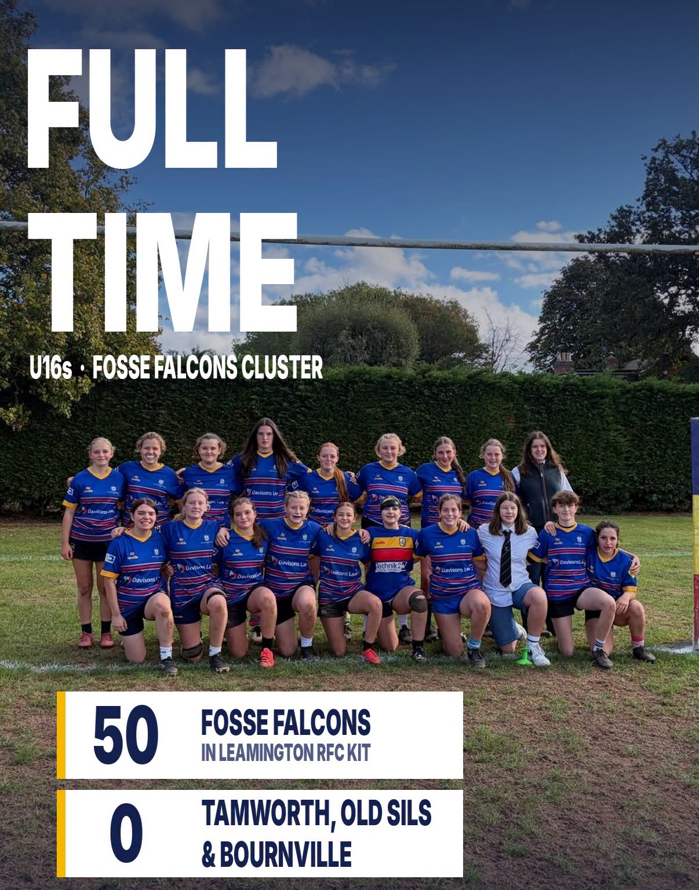
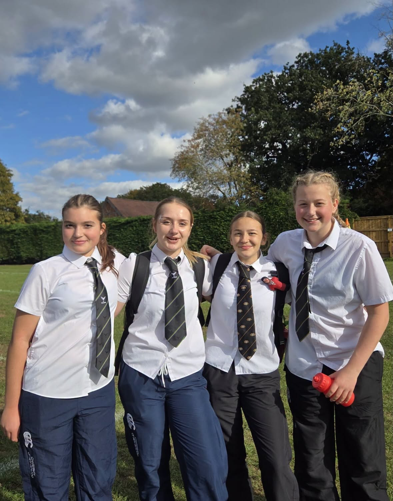

## FULL TIME at Kenilworth Road – U16s 

### Fosse Falcons 50–0 Tamworth, Old Sils & Bournville

Despite changes to the side (Rosie at hooker, Poppy’s first start at prop, Ella throwing in at the lineout), the Fosse girls started strongly. Big defence from Hope, Lilly, Ella, Eliza and Rosie gave the backs a platform, and Skylar, Ines, Izzy and Katie made big ground. The visitors made us work to the final whistle, so the scoreline doesn’t tell the full story.

Coaches’ player: Evie, who worked tirelessly and scored her first try.

First try for Ella too!

Players’ player: Skylar, who came back after a bang of heads with a bandage on and played brilliant heads-up rugby

Proudly wearing the Leamington RFC kit 💙💛❤️

