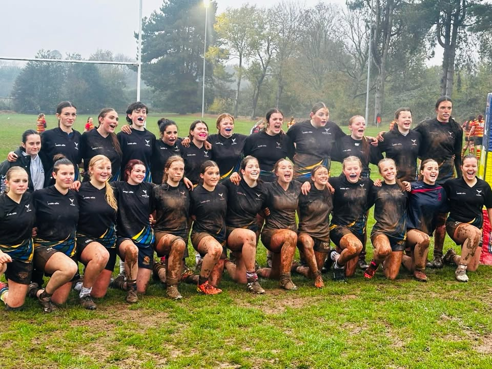
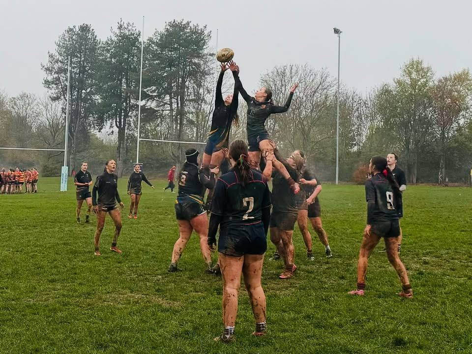
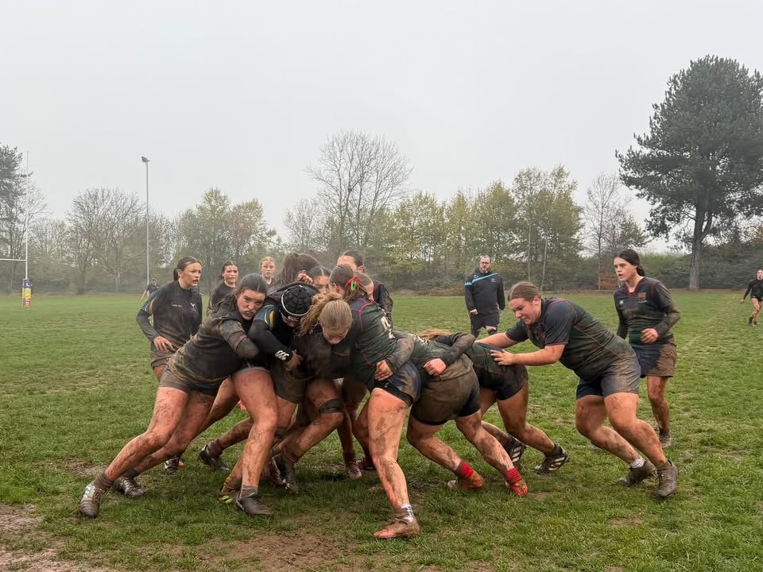
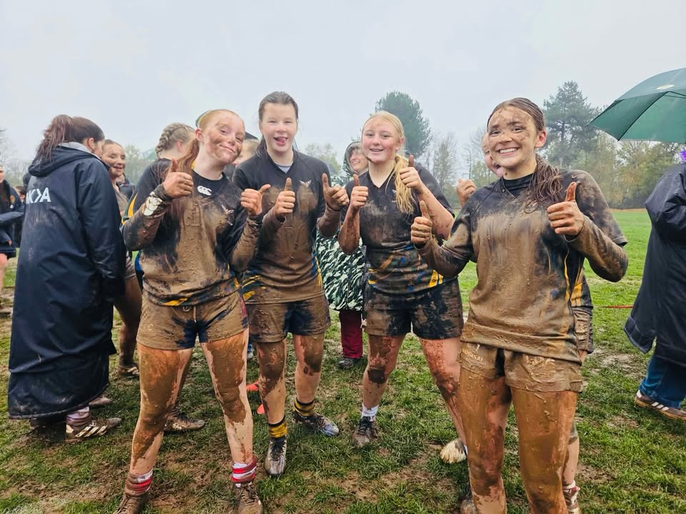
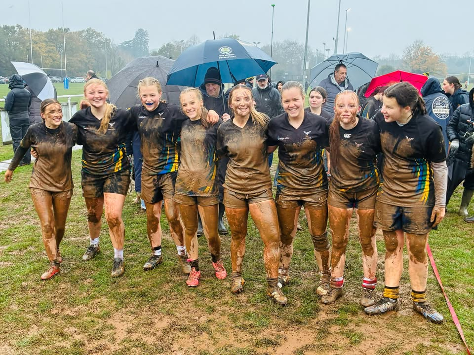

Mud&#44; rain and a proper battle at Leamington RFC&#33;   
  
From Coach Dewi&#58;  
  
“Our U16s welcomed an unbeaten Lichfield side on Sunday&#44; knowing they were in for a tough contest&#46;  
  
With torrential rain making conditions challenging&#44; the girls adapted brilliantly&#46; Rosie&#44; Hope&#44; Ella and Ruby worked tirelessly at the breakdown&#44; while strong carries from Elliza&#44; Georgia and Skylar kept Fosse moving forward&#46;  
  
Lichfield struck first&#44; but Katie J crashed over to bring the score to 5–7 at half&#45;time&#46;  
  
The second half saw more determined defence and some huge tackles&#44; but Lichfield added another try&#46; Fosse continued to battle&#44; with Skylar coming agonisingly close to scoring before the match was brought to an early end at 5–14&#46;  
  
Not the ending we’d hoped for&#44; but a fantastic display of determination&#44; teamwork and commitment against strong opposition&#46;”  
  
Players’ Player – Elliza for her powerful carries  
  
Coaches’ Player – Ella for her outstanding tackling and work at the breakdown  
  
Thanks to Lichfield for a competitive game&#46; We look forward to the rematch in February&#44; hopefully with a little less mud&#33;   
  
&#35;FosseFalcons &#35;GirlsRugby &#35;WarwickshireRugby &#35;News &#35;Ruggers

[Originally published on Facebook](https://www.facebook.com/122299632716035956/posts/122302556516035956).
